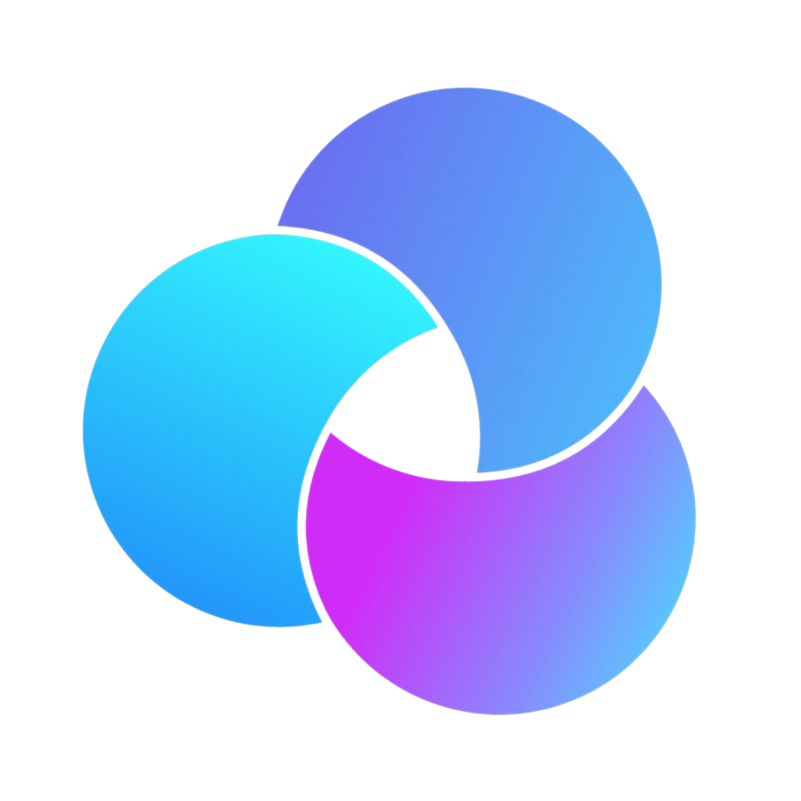

# Features

{ .skip-lightbox width="75" align="left" } Welcome to the features homepage! Here you'll find information on a variety of customization features available to you in the Trio app.  

- - -

Please use the navigation menu :fontawesome-solid-bars:, search bar :fontawesome-solid-magnifying-glass:, or the menu below to find the section you are looking for.

-   __[Bolus Calculator](bolus-calculator.md)__

    - - -
    
    Personalize the bolus calculator using these settings

-   __[Meal Settings](meal-settings.md)__

    - - -
    
    Adjust maximum meal absorption time and Fat/Protein settings
    
-   __[Shortcuts](shortcuts.md)__

    - - -
    
    Enable and set up shortcuts
    
-   __[Remote Control](remote-control.md)__

    - - -
    
    Allow remote control and find the shared secret used in Loop Follow
    
-   __[User Interface](user-interface.md)__

    - - -
    
    Personalize the User Interface with a variety of options and preferences
    
-   __[App Icons](app-icons.md)__

    - - -
    
    Change the Trio app icon
    

## Review and share configuration

[Export Settings](../export-settings.md) saves a selected-category CSV for configuration review. It is available from the main Settings screen.

## 1.0.2 source references

- **F08 — Document the Settings CSV export and effective-mode annotations**
    - [Trio/Sources/Modules/Settings/View/SettingsRootView.swift:394](https://github.com/nightscout/Trio/blob/0b29cd53415e7f0e668677749cad8daf81c68c2f/Trio/Sources/Modules/Settings/View/SettingsRootView.swift#L394)
    - [Trio/Sources/Modules/SettingsExport/SettingsExportStateModel.swift:1249](https://github.com/nightscout/Trio/blob/0b29cd53415e7f0e668677749cad8daf81c68c2f/Trio/Sources/Modules/SettingsExport/SettingsExportStateModel.swift#L1249)
