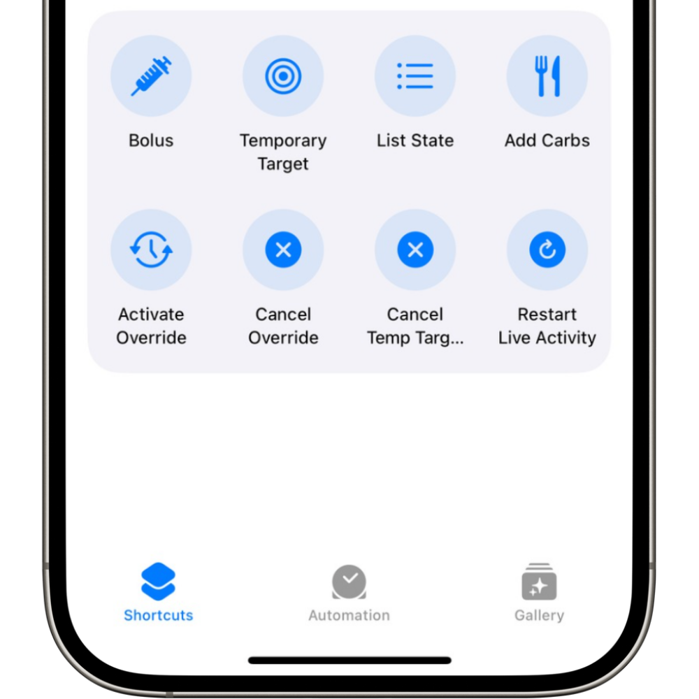

# Shortcuts

{width="400"}
{align="center"}

## Allow Bolusing with Shortcuts
**Default:** _OFF_  

Enabling this setting allows the iOS Shortcuts App to send bolus commands to Trio.

!!! tip
    Disabling this setting will still allow other Shortcut commands, like Temp Targets, Add Carbs, and Start/End Overrides.

- - -

## Available Shortcut actions: 

- [Bolus](#bolus) (if [enabled](#allow-bolusing-with-shortcuts))
- [List State](#list-state)
- [Add Carbs](#add-carbs)
- [Activate Override](#activate-override)
- [Cancel Override](#cancel-override)
- [Temporary Target](#temporary-target)
- [Cancel Temporary Target](#cancel-temporary-target)
- [Restart Live Activity](#restart-live-activity)

- - -

### Bolus

If [Allow Bolusing with Shortcuts](#allow-bolusing-with-shortcuts) is enabled, the internal `bolusShortcut` selection permits the validated bolus path (`limitWithSafetyChecks` rather than `notAllowed`).

Before rounding and enactment, the shared validator checks Max Bolus, available current IOB, Max IOB headroom, and cumulative boluses within the default **six-minute** lookback. A recent total **greater than or equal to 20%** of the requested amount rejects the request. Enabling permission does not guarantee a request will be accepted.

Logging external insulin is a separate action that does not deliver through the pump; that path has a bound of three times Max Bolus. It should not be confused with requesting a pump bolus.

- - -

### List State

Shows the last glucose reading, glucose trend arrow, time since last reading, and glucose delta. It also shows current IOB and COB.

- - -

### Add Carbs

Adds a carb entry into Trio.  

!!! tip
    You can also add fat or protein as part of the same entry.

- - -

### Activate Override

Activates a chosen preset override.  

!!! tip
    You must first save the Preset Override on the [Adjustments](../../../usage/interface.md#action-buttons) screen before you can activate an override using Shortcuts.

- - -

### Cancel Override

Cancels an already set override.

- - -

### Temporary Target
    
Activates a chosen preset temp target.  

!!! tip
    You must first save the Preset Temp Target on the [Adjustments](../../../usage/interface.md#action-buttons) screen before you can activate a temp target using Shortcuts.

- - -

### Cancel Temporary Target

Cancels and already active temp target.

- - -

### Restart Live Activity

Restarts Trio's live activity.

- - -

<!--TODO: Add a How to use Shortcuts & Automations page and reference it here-->

## 1.0.2 source references

- **F04 — Remote duplicate-bolus guard uses command time and a cumulative inclusive threshold**
    - [Trio/Sources/Services/BolusSafety/BolusSafetyValidator.swift:43](https://github.com/nightscout/Trio/blob/0b29cd53415e7f0e668677749cad8daf81c68c2f/Trio/Sources/Services/BolusSafety/BolusSafetyValidator.swift#L43)
    - [Trio/Sources/Services/RemoteControl/TrioRemoteControl+Bolus.swift:13](https://github.com/nightscout/Trio/blob/0b29cd53415e7f0e668677749cad8daf81c68c2f/Trio/Sources/Services/RemoteControl/TrioRemoteControl+Bolus.swift#L13)
    - [Trio/Sources/Shortcuts/Bolus/BolusIntentRequest.swift:16](https://github.com/nightscout/Trio/blob/0b29cd53415e7f0e668677749cad8daf81c68c2f/Trio/Sources/Shortcuts/Bolus/BolusIntentRequest.swift#L16)
- **F10 — Shortcut boluses use shared safety checks beyond the permission toggle**
    - [Trio/Sources/Shortcuts/Bolus/BolusIntentRequest.swift:14](https://github.com/nightscout/Trio/blob/0b29cd53415e7f0e668677749cad8daf81c68c2f/Trio/Sources/Shortcuts/Bolus/BolusIntentRequest.swift#L14)
    - [Trio/Sources/Services/BolusSafety/BolusSafetyValidator.swift:44](https://github.com/nightscout/Trio/blob/0b29cd53415e7f0e668677749cad8daf81c68c2f/Trio/Sources/Services/BolusSafety/BolusSafetyValidator.swift#L44)
